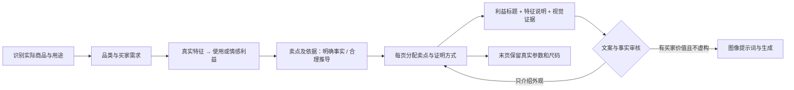

# 从外观描述改为买家利益

## 问题

护肤品案例从识别阶段被描述为“瓶罐包装”，规划进一步拆成渐变、轮廓、手持尺度、印字。事实与相机细节充分，但没有明确的购买理由。仅将“看清轮廓”润色成“轮廓各有不同”，仍然没有告诉买家为什么需要这个产品。

## 新链路

规划阶段保存 `sellingPoints`：买家需求、产品特征、买家利益、事实依据、明确/推导分类、不能扩大的承诺。每个营销画面以 `sellingPointIds` 对应具体卖点；规格页可以不关联卖点。合理推导独立保存，不能伪装成新事实。

这些数据会传入设计、审核和最终图像提示词，但不会作为额外文字画到图上。只有 `textBlocks` 是实际文案。

审核新增 `copy` 问题类别。对“仅介绍画面，没有买家利益”的页面必须局部改写；不能把它留作审美建议直接放行，也不能提交同样文字假装修正。已有参数、尺码表和用户要求继续受保护。

## 品类推导示例

以下是规则和测试样例，不是这套产品已经验证的功效。

| 已有信息 | 可以推导的购买价值 | 文案方向 | 不可据此推导 |
| --- | --- | --- | --- |
| 产品清晰标注为抗皱精华液 | 面向抗老护理需求的品类定位 | 把抗老护理，融入日常 | 淡纹幅度、见效时间、成分或临床效果 |
| 盖碗具有宽口 | 投茶操作的便利 | 宽口投茶，更从容 | 防烫、恒温、容量 |
| 衬衫具有宽松廓形和开襟 | 单穿、叠搭的搭配选择 | 单穿叠搭，都有型 | 面料透气、抗起球、显瘦保证 |
| 已确认充电器插脚可折叠 | 收纳与携带便利 | 折起就收好，出门少一份累赘 | 充电速度、功率、协议 |

美妆围绕实际品类、护理需求和已知配方；食品围绕已知风味与食用场合；家居围绕使用、收纳与空间搭配；图书围绕已知主题和阅读需求。包装颜色和拍摄视角负责展示卖点，不能独自承担整套购买理由。

资料少时允许使用合理的定性利益和日常情境。缺少关键参数时沿用一次补问流程，跳过后不编造；也不退回一整套颜色、形状、标签说明。

## 验证范围

- 105 项自动化测试通过，TypeScript 类型检查通过。
- 新规划要求卖点链，历史草稿仍可按原合同读取。
- 校验卖点依据、页面对应关系及“特征原样冒充利益”。
- 四品类样例验证卖点经过保存、设计上下文和提示词编译后仍保留；推理边界不会被插入实际文案。
- SDK 集成测试验证外观标题在生成前被改写，改后的文字与数据库、图像请求和版本快照一致，末页参数保持完整。
- 使用本地模拟模型端点验证流程；这不替代真实模型的创意质量验收。本次没有重新付费生成一整套图片。

测试日志：`ui-review/selling-point-regression.log`。
