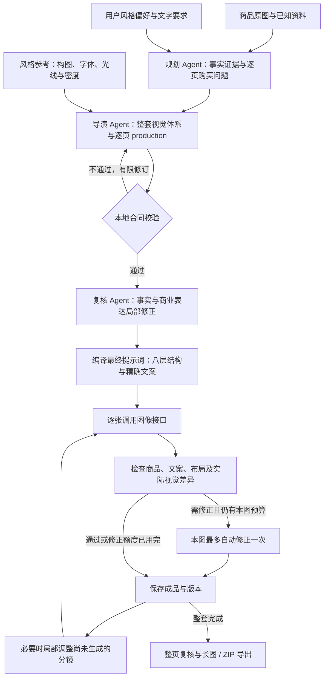

# 商业图文提示词重设计与参考逐页拆解

## 任务与证据边界

用户选择：**偏丰富商业图文，更强卖点标题、标注和信息层级**。目标是手机电商头图和详情分屏，默认保持项目的 1:1 / 3:4、用户数量和语言。视觉目标是明确的主次、真实摄影与有用的说明，不是把所有页面加满文字。

四张截图包含 48 个可辨认或局部可辨认的图位。截图下方的原始提示词大多过小、截断；部分页面被“+4”遮挡，保温杯第二行在画面外。以下“提示词骨架”均为根据可见成品逆向设计的建议，不是提取出的原始提示词。页面编号按截图中的位置，不能认定为原始下载顺序。未出现的页面不补造。画面中的性能、材质、包装与品牌文字也不能当作其他商品的事实。

## 参考 1：四套服饰详情缩略图

共同机制：人物先建立穿着愿望；衣服细节把愿望变成可观察的依据；室内/户外及远景/微距切换；文字嵌在自然空位，不覆盖面料或人体。四套各显示四个位置，第四个都被遮挡；每套其余四张不可见。

| 图位 | 可见内容与页面任务 | 构图、摄影、文字机制 | 逆向提示词骨架 |
| --- | --- | --- | --- |
| 蓝衬衫 A1 左上 | 海边男性上身，建立度假穿搭气质 | 人物偏右，左侧大字；海天浅色衬托深蓝衣服；完整展示领口和门襟 | 竖幅服装编辑摄影，模特自然站在海边，衬衫为主视觉；上身占约三分之二，左上保留短标题，两个小标签贴近下方；保留真实款式与面料，海面只作环境。 |
| A2 右上 | 同一服装的另一种度假造型 | 人物视线和姿态改变；左上手写感强调词，正文更小；不是重复 A1 标题 | 同款服装在明亮滨海步道，展示自然松量和搭配；改变取景距离与人物重心；用一条体验型标题和短说明承接开场，禁止新增未经证实的面料功能。 |
| A3 左下 | 领口、门襟与织物细节 | 深蓝织物铺满画面，侧光显纹理；局部小图或标注从属于大微距 | 把领口与门襟作为近摄焦点，布料有真实褶皱和纤维层次；左上轻量标题，底部小幅细节放大；说明只对应可见做工，不写猜测成分。 |
| A4 右下（遮挡） | 可辨室外穿搭与人物 | 深绿环境、深蓝衣服，顶部有标题；遮挡区不能判断 | 根据可见上半区，采用另一户外穿着情境，变换动作和画面明暗；其余构图/文字无法还原，不以“+4”覆盖区推断。 |
| 灰套装 B1 左上 | 室内站姿，展示整套轮廓 | 暖室内与灰绿服装协调；人物纵向占幅，左上短标题 | 自然窗光中的全身套装摄影，人物松弛站立，清晰展示袖长和裤长比例；主标题靠左上，次文案轻量；空间有前后层次。 |
| B2 右上 | 手触织物，说明材质观感 | 大面积斜向面料微距、手部压褶；文字随空白落位 | 微距展示手指轻捏原款布面，侧光突出织纹与垂坠；顶部标题、底部短说明分层；仅表达可见质感，不推断棉麻比例或透气性能。 |
| B3 左下 | 坐姿居家使用，连接生活 | 人物与藤椅形成动作关系，窗景更宽；上方简短说明 | 同款套装在窗边落座，展示坐姿下真实褶皱；摄影为主、短段说明为辅，保留衣服结构；改变站姿页的视角和占比。 |
| B4 右下（遮挡） | 可见户外全身行走 | 路面、绿植、人身尺度形成另一场景 | 仅能重建户外全身情境的方向；不能确认遮挡文案。使用不同步态、景深和构图证明搭配感，不复制室内站姿。 |
| 童装 C1 左上 | 牛仔背带裙的室内穿搭 | 儿童自然姿态、暖色玩具房；红蓝标题呼应衣服细节 | 儿童日常穿搭摄影，背带裙主体清楚，低干扰居家背景；标题与衣服点缀色呼应，分级排版，避免文字遮住款式。 |
| C2 右上 | 草地动态穿着 | 跑动/跳跃姿态与裙摆运动；绿色背景制造明快对比 | 在草地中展示轻快自然的动作，保留同一衣款及图案；人物靠中右，左上短标题；真实衣料运动，不凭画面声称弹力或防护功效。 |
| C3 左下 | 背带扣与绣花特写 | 红色扣件与牛仔织纹对比，局部注释建立信息 | 近摄实际背带扣、边线和绣花；以扣件为主焦点，旁边两条短标注分别指向真实部位；小图支持主细节，不等权拼贴。 |
| C4 右下（遮挡） | 可见手触牛仔布与绣花 | 接触动作支持面料说明；大部被遮挡 | 只依据可见区域设计手触布面近景；标题落在纹理平静处；不推断面料成分、亲肤检测或透气指标。 |
| 校园裙装 D1 左上 | 粉衬衫、领带与百褶裙的校园氛围 | 樱花色环境、人物偏右；左侧粉色主标题 | 春日校园穿搭，人物自然站姿，衣领、领带与裙褶清晰；主标题位于左上，辅助文案独立小区，背景虚化。 |
| D2 右上 | 户外行走，展示整套比例 | 林荫路纵深、全身步态、光斑；与首图有明显距离变化 | 同套服装在树荫步道行走，宽一些的全身构图；一条简洁体验标题配短说明，保留服装真实长度与褶型。 |
| D3 左下 | 领口和领带的材质细节 | 粉色织物铺底，领带形成斜线；标题与小型标注组合 | 宏观展示衬衫领口和领带纹理，斜向领带引导视线；顶部小标题、两条短标注，侧光显织纹，不推断棉含量。 |
| D4 右下（遮挡） | 可见百褶裙近景 | 裙褶的重复线条成为视觉证据，正文不可读 | 聚焦实际裙褶形态及自然垂落，采用腰部以下裁切，保留褶数和颜色关系；遮挡区域不尝试还原。 |

## 参考 2：吹风机头图与盖碗头图

吹风机不是八张同角度摆拍：从产品身份到手持、实际动作、结果感、居家关系、细节、使用者、信息汇总。截图中的“速干、护发”等只能作为原案例的文案观察，复用时需要商品证据。

| 图位 | 页面任务 | 构图与层级 | 逆向提示词骨架 |
| --- | --- | --- | --- |
| 吹风机 H1 上排1 | 清新产品身份 | 薄荷绿产品右置，左侧标题和小标签，窗光植物投影 | 方形主图，薄荷绿原款吹风机为主；自然窗光、柔和绿植虚景；左上强标题，左下少量已知特征标签，产品轮廓在缩略图中清晰。 |
| H2 上排2 | 手持尺度与握持 | 手握把柄提供尺度；右侧实物、左侧文案 | 手自然握持原款把柄，手指接触和电线走向可信；让握持部位清晰，标题与两条已证实说明置于另一侧，不从手持画面推算重量。 |
| H3 上排3 | 实际吹发动作 | 发丝横向运动形成动势，吹风机进入画面；标题在空区 | 近景吹发使用动作，发丝有方向与层次，工具保持原款形态；清楚展现动作关系，文案仅采用确认的功能，不虚构风速和耗时。 |
| H4 上排4 | 使用者与头发观感 | 大面积背面发丝，产品在侧；温柔亮背景 | 用后背发丝与侧置商品形成主辅关系，统一窗光；若无功效证据，只表达日常造型情境，不做前后效果承诺。 |
| H5 下排1 | 融入居家环境 | 镜面、台面、绿植与产品共同构成真实空间 | 梳妆台上的产品静物，中景保留镜面和花器作为背景；产品大小可信、接触阴影明确；标题与场景留白结合。 |
| H6 下排2 | 可见结构与表面质感 | 斜向大特写搭配一处局部说明 | 放大实际风口与壳体连接处，窄高光显表面；主标题小于封面，微距占主导，少量标注指向真实结构，禁止虚构内部电机剖面。 |
| H7 下排3 | 人物使用情境 | 女性侧身、手部与发丝动作占主体；旁边条列 | 明亮室内的半身使用摄影，用真实动作串起人物、头发和机器；在稳定留白区放两三条有依据的使用信息。 |
| H8 下排4 | 信息型总结 | 右侧完整产品、左侧多行图标式说明 | 产品右置、信息左置，标题最强，三组短标签与一句说明分层；图形风格统一，所有功能文案来自确认事实，不借图标制造认证暗示。 |
| 盖碗 H1 下方1 | 品牌气质与整体产品 | 暖木桌、斜阳、正面成套盖碗，窄纵排文字 | 方形暖调盖碗静物，桌面细纹与釉面高光清晰；让青花为色彩中心，侧边少量竖排文字；不用装饰压过器型。 |
| H2 下方2 | 手触盖钮与花纹工艺 | 紧凑手部微距，前后景分离 | 近摄手指触碰真实盖钮，焦点落在釉面、钮形和原有花纹；短文案贴近暗部或留白，禁止编造烧制温度与手工工序。 |
| H3 下方3 | 冲泡动作与人的关系 | 手持盖碗、桌上杯具构成使用链 | 室内茶席中自然持器，手部动作准确、器具接触合理；主图表达使用情境，文案克制但清楚，不把场景茶杯标成随赠。 |
| H4 下方4 | 可见部件与选购理解 | 盖、碗、托分开陈列；纵排说明和底部信息 | 仅将已确认可分离的三件在同一平面依次展示，统一视角与比例；部件名称和短说明分级摆放，不使用无依据的爆炸内部图。 |

## 参考 3：红色饮水器具与卡通保温杯

红色商品截图存在语言和低清限制，其具体功能不能仅凭形状确定。下面以“红色饮水器具”描述外观，不认定内部结构、果汁功能或附带配件。

| 图位 | 页面任务 | 构图与层级 | 逆向提示词骨架 |
| --- | --- | --- | --- |
| 红色 R1 上排1 | 情绪开场与产品识别 | 红色长条器具近景、浅粉环境和花朵 | 竖幅大产品主视觉，粉红环境衬托透明或半透明外观；单一强标题，次文案弱化；花朵只作背景，禁止暗示成分。 |
| R2 上排2 | 特征说明 | 产品放大靠右，左侧图标/分组文案 | 把实际可见特征分成两三组，左侧清晰短标注对应右侧部位；一处标题最强，文字大小适合手机，不补未知性能。 |
| R3 上排3 | 办公桌情境 | 笔记本与桌面纵深，产品自然放置 | 办公桌上展示商品日常陈列，背景电脑虚化；产品有真实接触和透光，标题不压过主体；不以电脑场景推导功能兼容性。 |
| R4 上排4 | 视觉吸引与材质 | 商品斜向，水果/水滴等元素营造鲜活感 | 采用倾斜构图与真实透明材质表现；只有商品确为饮品且有依据时才使用相关水果/液体，否则改为非成分暗示的光影元素。 |
| R5 下排1 | 对照型选择理由 | 暗色普通外观与红色商品左右对照，中央对照符号 | 若存在真实对照依据，左右等视角展示客观外观差异；无依据则改为同一商品两种使用情境，不能编造竞品缺陷或性能数据。 |
| R6 下排2 | 穿搭/生活方式关系 | 人物为中景，产品在桌面前景，标题偏侧 | 用前景商品、中景人物、远景环境建立三层空间；标题说明已确认的日常用途，最多两条从属信息，不声称健康效果。 |
| R7 下排3 | 礼赠情绪 | 暖光、礼盒、丝带、花材；强短标题 | 只有已确认包装才作为商品交付内容；否则用环境花材与手递商品表达赠礼情境；保持产品主导，避免暗示豪华盒随附。 |
| R8 下排4 | 场景与信息收束 | 上部较大场景，下部多视角/部位条带和说明 | 上部主画面占约三分之二，下方用真实不同视图与短标签解释选购信息；小图同款同色，不凭空生成款式或规格。 |
| 保温杯 M1 下方上排1 | 温柔生活方式开场 | 奶白粉杯、花、书与桌面，整体柔暖 | 原款杯作为前景主角，书和窗光建立居家情境；短标题配少量有依据卖点，杯身图案保持一致。 |
| M2 上排2 | 握把/杯身细节 | 杯体近景、柔软织物，标签与圆形细节区 | 放大实际握把与杯身连接，织物只是布景；一处局部放大加短说明，避免重复贴满装饰徽章。 |
| M3 上排3 | 结构/特征说明 | 产品与分离视图、指示线及底部图标组 | 仅依据真实多视图或商品说明展示杯盖与可拆部件；清晰引线连接短标签，下方小组说明归纳，不凭外观画出真空夹层。 |
| M4 上排4 | 工作场景 | 笔记本、杯子、桌上小物 | 以真实桌面透视展示杯的使用关系，和 M1 改变光向、距离与动作；说明适用情境，不填未知容量或保温时长。 |

保温杯第二行只露出极少边缘，不足以分析四张完整页面；不作为已完成拆解项。

## 参考 4：青花盖碗八个清晰图位

按画面位置编号：上排 T1–T4、下排 T5–T8。整套的核心是暖木/米金环境、青花冷色对比、统一方向光、细窄书写感字体与真实手部动作。文字有多种落位：竖排、段落、底部横排；同一套字体不等于同一套版式。盖碗本身始终是最强证据，礼盒和防烫等文字需要另外的商品资料支持。

| 图位 | 购买问题/页面作用 | 构图、光线和信息分析 | 逆向提示词骨架 |
| --- | --- | --- | --- |
| T1 上排1 | 如何使用，是否有茶席仪式感 | 斜阳照亮桌面，手掀盖构成瞬间动作；商品在下半区，竖排字落在右上较暗背景 | 暖木茶室中一手托住碗托、一手自然掀盖，三件结构保持原款；焦点在手与盖口，远处木柜轻虚化；右上窄竖排短文案，避免盖碗边缘被文字遮挡。 |
| T2 上排2 | 器型和青花是否值得细看 | 完整产品略靠下，釉面有受控亮点；暖灰桌面与奶金墙面大留白；右上小竖排 | 近中景完整盖碗，柔和侧逆光让釉面有透明高光，花纹边界清楚；主体占画面下方一半，右上以小竖排说明真实外观，克制的背景虚实变化。 |
| T3 上排3 | 盖、碗、托如何组成 | 三个真实部件横向分布，底部一块较密说明，顶部轻品牌区 | 以三件分开展示作为主视觉，盖偏左、碗居中、托立于右；自然接触阴影与比例；底部排两三行分组说明，标题与正文强弱清晰；所有组件必须有来源。 |
| T4 上排4 | 拿取与盖钮尺度 | 两只手上/下形成框架，商品清晰大；右侧竖排信息 | 上手轻触盖钮、下手稳托碗托，近景展示真实抓握关系；用侧光突出边缘釉感；在右侧窄区放一段有依据的握持说明，手指数量与接触点真实。 |
| T5 下排1 | 倾倒动作是否直观 | 上方手持盖碗，茶流把视线导向底部杯；左侧竖排文字 | 摄影定格实际倾倒动作，茶流连接两只器皿，透视与液体重力合理；盖与碗的相对位置可信，左侧简短操作说明；不要据画面推断“完全不烫”等功效。 |
| T6 下排2 | 放进日常空间是什么感觉 | 场景更宽，茶席和多个杯构成生活叙事；左上短段落与花枝投影平衡 | 拉远到真实茶席中景，商品保持最清晰焦点，陪衬杯具略小；暖墙投影、木桌细纹、花枝形成层次；左上短段落讲场景价值，不将陪衬标为套装清单。 |
| T7 下排3 | 礼赠呈现与交付 | 打开的盒子作主视觉，花束在侧；底部横排短段落 | 如有真实包装资料，准确展示包装打开后的陈列和内衬；花束作为情境陪衬；底部短文案与上方照片区形成编辑式分区。无包装资料时改为手递商品。 |
| T8 下排4 | 以温和产品记忆结束 | 大留白、手托完整器型，右上竖排；比开场更静 | 浅暖背景中从侧下方托起同款盖碗，釉面与手部受同一柔光；将产品落在下半区，右上短竖排收束语；保留一个清晰购买记忆，不新增新卖点。 |

## 三个开源参考的取舍

- [DetailFlow](https://github.com/AJbeckliy/detail-flow/blob/main/SKILL.md)：借鉴同一购买叙事、页面密度变化、主辅内容与局部修订的思路。项目继续使用自己的画幅、数量和自动任务控制，不照搬固定屏数与人工审批流程。
- [1Click Ecom PDP](https://github.com/coolqoo/1click-ecom-detailpage/blob/main/SKILL.md)：借鉴先确定购买理由、锁定整套视觉、先定清晰图内文案再写出图指令。不采用其可模拟评价/数据的建议，也不把英文设为所有项目的默认输出语言。
- [WatchaAI 工作流](https://github.com/WatchaAI/e-commerce/blob/main/商品详情页skill/ecommerce-detail-page-workflow/SKILL.md)：借鉴将参考拆解为逐页构图、字体、光线、内容职责，再为每页形成独立可执行指令。保留商品原图作为身份依据，不自动以 AI 精修后的新图取代真实证据。

以上仓库作为研究材料，没有安装或执行其中的脚本，也没有把外部文件中的命令当作用户授权。

## 现有输出为何显得简单

直接查看 `ui-review/creative-v3-overview.png` 后可见：前三张头图相同倾斜物体、相近尺度和灰白背景；中间两张细节继续把较大机身作为主焦点；末页仍是相似摆拍加小字。旧验收记录为 7 张中 6 张纯摄影。光影本身并非完全不可用，但页面职责、人物/动作、辅助证据、字体比例和真实情境都不够。

代码层原因：V3 允许灵活表达，但对“纯摄影、删除无用文字”的说明远强于“如何组成成熟商业图文”；最终提示词缺少明确的购买问题、可见证据、主辅信息结构、材质处理和相邻页差异。抽象的 `compositionBrief` 很容易只输出“物体居中，背景干净”。

## 落地后的提示词结构

| 层 | 由谁提供 | 进入图像模型的内容 | 判断标准 |
| --- | --- | --- | --- |
| 1 本页购买问题 | 内容规划 + 导演 | audience、positioning、buyerQuestion、buyerTakeaway、narrativeLink | 单看各页任务，也能读出清楚的购买叙事 |
| 2 依据与商品身份 | 事实计划 + 原图 | 本页及辅助模块引用的证据；真实商品身份边界 | 不将印字变成实测，不把道具变成配件 |
| 3 整套视觉体系 | 视觉导演 | concept、palette、lighting、字体家族 | 同一视觉语言，不同的实际布局 |
| 4 主次构图 | 逐页 production | visualProof、layoutBlueprint、supportingModules | 一处主焦点，辅助证据有位置、有作用 |
| 5 拍摄与材质 | 逐页 production | camera、background、materialTreatment、interaction | 真实表面、方向光、接触阴影与自然动作 |
| 6 精确文案 | 导演定稿 | copyArchitecture、typography、textBlocks | 标题强、标注准、手机能读；只画批准文字 |
| 7 整套节奏 | 导演 + 编译器 | 前后页任务、differenceFromPrevious、连续边缘 | 不靠换标题或旋转几度假装差异 |
| 8 输出约束 | 固定流程 | 单张画幅、商品保真、局部接缝、无界面元素 | 完整成品图，不是设计说明板 |

新建 V3 分镜每页必须提供 production。老 V1/V2/V3 存储仍可读取；已定稿老任务使用原已保存提示词。无需数据库迁移，没有增加依赖、出图轮次或自动重试预算。



商品原图负责 SKU 身份，风格参考负责设计方法。两类图像在输入中分别标记；`referenceUses` 只能使用明确提供的风格参考 ID。真实验收中发现过 Agent 混用编号，因此补充了白名单输入和包含实际错误编号的反馈。

真实预检另发现两处问题并修复：整套分镜篇幅超过普通检查，故只把该请求的超时上限从 90 秒调整为 180 秒，同时要求简洁字段；规划/文案增加对“读懂印字”“能确认与不能确认”“作为外观信息呈现”等内部报告语言的校验。用户明确要求的核对任务和原样文字仍按用户要求保留。

例：已确认折叠插脚可表达为“展开使用，折起收纳”，而不是“图中可见两根插脚”；标签可直接写“折叠插脚”，不加“可确认/作为外观信息”等前缀。画面中的商品原有印刷仍须保真，但不为读取品牌字样单独凑一页详情。

### 单页结构示意（非商品性能承诺）

```text
成品：1:1 电商画面，一张完整作品。
购买问题：买家如何看清这款器具的结构和使用关系？
画面证据：原图实际可见的部位；不展示未知内部结构。
视觉主线：整套一致的色温、材质与标题家族。
主构图：商品在右侧约 60% 区域，清晰的斜侧摄影。
辅助信息：左下一个真实细节放大区，上方两条与部位对应的短标注。
拍摄：明确主光方向、接触阴影和表面高光；背景有层次。
文字：标题、标签和说明分别给出精确文本、位置、尺寸层级与颜色。
节奏：上一页是环境远景，本页转为近距离结构解释。
约束：保持 SKU；不增加功能、认证、数据；不重复绘制同一文字块。
```

## 自动化验收范围

先运行结构与流程回归，检查新字段经设计工具、持久化、编译及真实适配器请求完整传递；检测失效文案索引、未知事实引用、纯摄影信息图混入，以及旧版兼容。另运行 TypeScript 检查。

实际图片验收另建隔离项目，同一原始商品、3 张主图 + 4 张详情、沿用现有模型与画质。保存最终逐页提示词与概览；将程序通过、模型判断和人工目视观察分别记录。自动测试通过不能证明最终视觉已成熟。

### 实测后补充的规则

1. **先核对原图，再组织叙事。** 本轮旧项目描述把圆柱插脚写成“可折叠扁插脚”，规划 Agent 又将文字推断标为了 image 证据。仅有有效图片 ID 不能证明该断言正确。新规则要求独立查看原图、区分文字与图像来源；出现直接外观冲突时保留实际形态，争议内容不进入图文。单张展开状态照片不能证明折叠、拆卸或变形过程。
2. **辅助信息要就近、可核对。** 本轮出现 USB 细节窗的引线连到插脚的错误。新规则优先使用局部标签；只有能准确落在对应部位时才使用引线，不让长线跨越其他结构。
3. **微距必须改变主画面。** 实测的“微距”仍把几乎完整商品放在画面中。编译器现在对 macro 任务明确要求：真实细节占据主摄影区，允许其余商品离开画幅，完整摆拍加小窗不能代替微距。导演规则也明确环境页必须给真实情境足够空间。

这些规则来自本轮实测发现。来源冲突规则加入规划、导演和检查提示词，引线规则位于导演提示词，微距规则进入最终出图指令。它们属于提示词约束，不是确定性的视觉识别保证。微调后重新执行核心与流程测试；本轮已生成的旧分镜不自动改写，也未为验证这些规则追加第二套付费生成。详见 [验收记录](commercial-prompt-acceptance-2026-10-01.md)。
