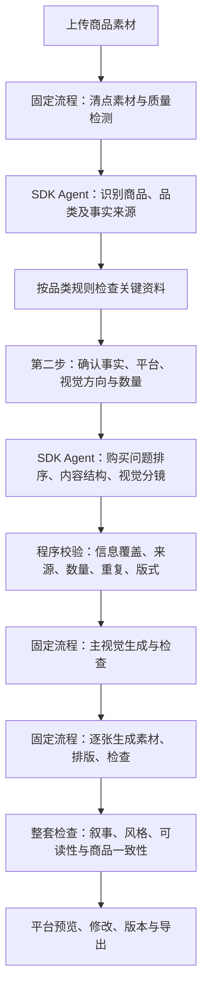

# MxPage 商品内容规划与移动端预览重构方案

研究日期：2026-09-29。状态：规划稿，尚未修改生成流程或付费出图。

目标：上传商品素材后，得到适合该品类、能够帮助消费者作出购买判断的一套头图和详情图，并在有明确版本基准的淘宝移动端页面中完整预览。

## 1. 本次调研与现状判断

通过用户 Chrome 实际查看了京东的以下商品头图及详情片段。它们是视觉研究样本，不是已验证的转化率最佳案例，也不能作为用户商品参数的来源。

| 样本 | 实际观察 | 可采用的设计方法 |
| --- | --- | --- |
| [绿联充电器](https://item.jd.com/100015338543.html) | 头图突出产品和关键卖点；详情使用深色科技主视觉、功能概览、场景和参数 | 将技术信息翻译成购买理由；大图、功能说明和规格各自承担不同职责 |
| [Kappa 板鞋](https://item.jd.com/100094210951.html) | 上脚构图、柔和同色背景、材质近景，详情中有穿搭画面及商品资料 | 用穿着情境和比例表达款式，近景解释做工；服饰不套数码参数海报 |
| [西昊 H300Pro](https://item.jd.com/100308884081.html) | 人物坐姿、真实工作空间、结构展示与参数资料 | 家具需交代人、商品、空间的关系，结构说明必须有实际资料 |
| [珀莱雅精华](https://item.jd.com/100024425098.html) | 包装色延伸为页面主色，精修瓶身、肌肤诉求、成分/功效主题 | 用包装、质感和适用需求组织画面；功效结论必须有来源 |

这些样本也有过长活动区、交叉销售广告和密集促销文字，不应整套照搬。提炼构图、信息层级和阅读节奏，重新为用户商品创作。多色、多版本展示必须标明对应款式；默认整套锁定同一个 SKU，不能把不同参考商品或色款混成用户的一个商品。

公开资料补充：京东设计体系强调清晰、真实、自然及克制的背景；Baymard 的研究支持用图像配合简短说明解释关键功能，并指出服饰等穿戴产品需要人体情境帮助理解比例。这些是设计依据，不是平台最新上传规范或效果保证。

- [京东：产品图像设计](https://jdrdl.jd.com/Design-image.html)
- [Baymard：用功能亮点组织商品描述](https://baymard.com/research-articles/structure-descriptions-by-highlights)
- [Baymard：图像中的说明文字](https://baymard.com/research-articles/product-images-descriptive-text)
- [Baymard：穿戴产品的人体情境](https://baymard.com/research-articles/human-model)

淘宝标签页被浏览器站点安全策略拦截，未读取其页面，也未绕过限制。本轮未取得手机淘宝 App 的固定参考版本，因此目前不能确认任何实现已经达到淘宝移动端 1:1。

现有代码的关键问题：

1. `creative-rules.ts` 是一组通用创作原则，平台差异主要是一句话；没有品类、购买问题或必需信息的规则。
2. `planSchema` 只有事实字符串、风格字符串和逐图提示词，无法校验卖点来源、模块职责、信息覆盖和重复。
3. 商品分析同时提出视觉方向，容易把原图的白底、角度和摆放方式带入整个套图。
4. 上次充电器方案把接口、插脚、印字、外壳拆为多张外观图，缺少明确的产品定位、适用性和选购说明。
5. 质检集中于单图一致性、文字和风格；9 张模型检查通过并不代表整套内容具有足够的商业表达能力。
6. 当前手机组件是通用图片查看器，商品信息区、导航和底栏不是淘宝界面。

## 2. 重新定义头图与详情的任务

头图负责让用户快速认出商品、理解最重要的价值，并愿意继续看。详情负责解释价值如何成立、是否适合自己、应该如何选择。

默认 4 张头图的职责：

| 顺序 | 任务 | 常用画面 |
| --- | --- | --- |
| H1 | 产品身份与一个主卖点 | 经过设计的主视觉：清楚的产品、短标题、明确主次 |
| H2 | 最重要的使用收益 | 场景、上身/上脚、操作或用途展示 |
| H3 | 支持主卖点的证据 | 材质、结构、真实细节或有依据的数据图解 |
| H4 | 帮助选择与建立预期 | 规格/版本/包装内容/真实多视角，按资料可用性选择 |

详情按决策问题排序，可合并为默认 6 张，也可根据品类扩展：

1. **是什么、为谁而设计**：明确定位、适用需求与首屏主视觉。
2. **为什么值得考虑**：选出有依据的主要优势，避免堆砌所有属性。
3. **优势如何体现**：用图像、实物细节或经过确认的数据解释。
4. **在我的情境中是什么样**：实际使用、穿搭、空间、质地等。
5. **是否适合、怎么选**：尺寸、版本、兼容性、肤质、型号等品类决策信息。
6. **到手后会获得什么、如何使用**：包装清单、使用方法、护理及已提供的服务说明。

这不是要求每个商品强行生成相同六屏。内容模块和导出图片数量分开：一张可承载关联的两个短模块，一个重要主题也可占完整画面。品牌故事、对比、认证、评价、售后只在资料充分且有用时加入。

保留现有数量选择；增加“按内容推荐”的建议。资料不足时在第二步提示缺少的关键资料，建议减少数量或补充后生成，不静默改变用户明确选择的数量，也不靠重复外观图凑数。

## 3. 按品类决定信息和视觉

品类只是起点。最后方向由“品类 × 子品类 × 用户需求 × 价格定位（用户提供时）× 品牌资产 × 平台”共同决定，允许用户纠正识别结果。

| 品类 | 购买决策重点 | 头图视觉 | 详情视觉与结构 | 需要确认的资料 |
| --- | --- | --- | --- | --- |
| 3C / 数码配件 | 接口、适用设备、性能、体积、安全依据 | 清晰轮廓、定向光、少量强调色；一个主要技术利益点 | 场景 → 功能解释 → 真实接口/结构 → 兼容/规格；深浅画面有节奏 | 型号、输入输出、协议、尺寸、认证及适用范围 |
| 服装 / 鞋包 | 穿着效果、版型、面料、尺码、搭配 | 全身/半身/上脚、自然动作，色彩与商品协调 | 正侧背/穿搭 → 面料与工艺 → 尺码和选择 → 护理 | 成分、尺码表、颜色、模特数据；生成模特不能被当作实测尺码证据 |
| 美妆 / 个护 | 适用需求、成分、质地、方法、效果依据 | 包装精修、品牌色、质地关联画面，避免默认水花 | 诉求 → 有依据的成分/功效 → 质地/使用 → 适用人群与规格 | 配方、质地照片、用法、适用范围、功效支持资料 |
| 食品 / 饮品 | 口味、成分、分量、食用方式、保存 | 食物状态、食欲感、搭配或包装，暖/冷色按品种选择 | 风味 → 原料 → 食用情境 → 净含量/组合 → 保存 | 配料、过敏原、净含量、产地、保存与保质信息 |
| 家具 / 家电 | 空间适配、尺寸、操作、结构、安装 | 真实居住/工作空间、人和商品的比例 | 使用情境 → 功能 → 材质/结构 → 尺寸安装 → 使用维护 | 尺寸、容量、结构资料、安装要求；没有尺寸不能画精确比例图 |
| 家居日用 | 用途、容量、收纳、清洁、耐用依据 | 自然生活场景、干净光线，重点物件明确 | 使用任务 → 操作演示 → 材质细节 → 尺寸/收纳 → 清洁 | 材料、尺寸、容量、清洁方式、包装数量 |

通用品类兜底：产品主视觉、真实用途、可见细节、已知规格，用户确认品类后再启用专属模块。母婴、保健等不直接套用通用功效文案。

## 4. 视觉提升的具体机制

上传图默认作为**商品身份参考**：锁定外形、比例、颜色、接口、插脚、标签和包装。不再默认作为背景、构图或风格参考。用户另行选择的风格参考独立保存。

可以重新设计环境、构图、照明、阴影、主体尺度、留白和文字层级。需要新角度或遮挡处细节时，先判断原素材是否足够；不能为了新鲜感画出不存在的结构。

每套保存一份可执行的视觉方案：

- 主色、辅助色、强调色及允许的深浅背景。
- 标题和正文层级、对齐方式、安全边距与字号下限。
- 主体的构图位置、摄影/合成方式、光线方向及背景材料。
- 每张图的布局类型和阅读顺序；相邻模块避免重复的大居中产品构图。
- 需要生成的场景素材、必须保留的产品部分、精确最终文案。

默认生产方式改为“商业图像素材 + 程序排版”：图像模型负责产品场景、光影和质感，程序负责标题、参数、图标、标签和整页栅格，再输出最终 PNG。这样可以稳定字体、修正文案、控制移动端可读性，减少整张重生成。商品本体已有印字依然属于图像，需要专门核对。

为保持设计弹性，采用数种可配置版式：全幅主视觉、左右/上下分区、场景叠加文字、细节标注、规格表和组合展示；由规划选择，不把所有图片做成同一种卡片。

先生成一张会用于交付的主视觉，作为后续色彩和光线参照，自动检查后再继续。它计入已选数量，不额外生成收费的“风格样片”。实际产品主线默认自动完成，用户只在第二步调整方向；本次开发验收阶段可先审阅少量样张再批量跑图。

建议把 3:4 保留为详情单图默认，允许后续按内容使用适量横向短模块；整页按同宽连续组合，不强迫所有模块等高。跨页文字和内容不能被切断。平台上传尺寸限制另行核实并记录版本，1080 px 长图仍作为当前交付格式。

## 5. 新规划与执行路径

Agent 用于需要理解和判断的工作：商品分析、内容规划、视觉判断。队列、调度、重试、版本、排版、导出及任务恢复继续使用固定 workflow；复用官方 SDK，不增加多 Agent 自由协商。

第二步默认展示：主图、可纠正的品类、已确认的商品说明、简短的缺失资料提示、推荐视觉方向、平台/语言/数量/画质。完整分镜可展开查看，不要求逐页确认。

结构化方案新增（作为版本 2 JSON 保存，先复用已有快照和分区数据）：

| 结构 | 要解决的问题 |
| --- | --- |
| ProductFacts | 每条事实的来源、证据图片/区域、用户确认状态；区分可见印字与真实性能 |
| CategoryProfile | 子品类、用户需求、必需模块、需确认资料、不能自动推断的内容 |
| ContentPlan | 每张图对应的购买问题、核心信息、事实引用、选用原因、信息优先级 |
| VisualSystem | 配色、字体、栅格、光线、影调及参考素材角色 |
| SectionBrief | 内容职责、画面类型、构图、精确文案、生成素材/程序排版、检查要求 |
| PreviewProfile | 平台、参考版本、逻辑视口、商品字段与页面状态 |

程序预检阻止：无来源数字和承诺、把印字当性能、重复标题/内容、没有对应素材的结构图、错误数量和缺少该品类必需信息。语义和视觉质量由模型辅助判断，不能伪装成绝对可靠的程序校验。

检查分三层：商品与事实、单图可读性、整套内容和视觉。程序能检查的字数、排版溢出、图片尺寸、顺序先确定性检查；视觉一致性和场景真实性由模型查看原图与成品，整套风格检查查看缩略总览。局部文字错误优先重排版；需要重新绘制才调用图像模型，保留每图最多一次自动图像修正及不确定请求暂停机制。

## 6. 充电器示例方案

当前原图支持确认的外观信息包括黑色机身、HAVIT / 65W 可见印字及圆形插脚。不能据此确认真实额定功率、快充协议、温控、内部结构或地区兼容性。先前识别仍存在错误，不能直接复用未确认的分析结论。

建议推荐方向：**石墨黑 × 冷白 × 少量冰蓝的数码产品广告视觉**。用轮廓光表现黑色机身，主视觉用有纵深的构图；穿插明亮的产品信息与接口图。装饰服务于主体，不画电流、内部芯片或拆解结构来暗示不存在的技术。

可选方向：

| 方向 | 适合表达 | 画面特征 |
| --- | --- | --- |
| A 数码性能感（推荐） | 已有充分技术信息的数码配件；缺少信息时只表达外观和使用需求 | 石墨黑、冷白、少量蓝色，产品轮廓清楚，图解和场景交替 |
| B 日常生活感 | 关注居家/桌面搭配的人群 | 暖白、木质和自然光，产品进入真实环境 |
| C 简洁品牌感 | 希望克制、耐看的品牌表达 | 大留白、严格对齐、精修质感，文字更少 |

以 4 头图 + 6 详情为例的内容意图如下；条件未满足的模块不得直接执行：

| 图位 | 内容意图 | 视觉安排 | 前置事实 |
| --- | --- | --- | --- |
| H1 | 清楚识别产品与定位 | 重新布光、商业构图的产品主视觉 | 名称与外观确认 |
| H2 | 一个最强购买理由 | 产品与真实使用需求结合 | 用户确认的主要卖点 |
| H3 | 理解接口与连接 | 实物近景配准确标注 | 接口类型/数量及适用信息 |
| H4 | 建立到手预期 | 产品/配件或准确规格组合 | 包装清单或尺寸资料 |
| D1 | 产品定位与首屏主视觉 | 独立的详情首屏构图 | 名称、定位 |
| D2 | 为什么适合目标需求 | 场景和关键收益 | 用户确认的用途，不暗示未确认兼容性 |
| D3 | 核心能力解释 | 数据/功能图解，配产品局部 | 铭牌、说明书或用户提供规格 |
| D4 | 接口与插脚说明 | 实物细节和清楚指引 | 接口信息、适用范围 |
| D5 | 型号与规格选择 | 短表格/尺寸图，信息优先 | 型号、尺寸、输入输出等 |
| D6 | 到手清单及使用说明 | 有节制的产品组合、短步骤 | 配件、说明书或使用资料 |

只上传当前这一张图时，系统应在第二步集中提示最影响购买判断的资料缺口。用户跳过后省略未确认技术内容，提供清楚的外观展示方案和较少张数建议；不能再把“机身印字”“圆角外壳”包装成六个卖点。不得将待确认、识别不确定等内部备注画进对外营销图。

## 7. 淘宝移动端 1:1 预览的边界与验收

目前尚未确认 App / H5，规划暂以手机淘宝 App 商品页为目标；如果选择 H5，需要独立基准，不共用未经验证的尺寸。

1:1 的可执行定义：**针对固定平台版本、系统、屏幕逻辑尺寸和页面状态，复刻可见结构、尺寸、样式及关键交互**。不是用同一个手机外框近似所有淘宝版本，也不承诺不同活动/用户/版本的线上页面永远相同。

实现前需要一套固定参考：顶部头图页、商品信息/SKU 区、详情起点、详情中段及底部固定栏；另加图片查看器和 SKU 弹层。保存参考版本、设备/视口及截图时间。淘宝访问受限期间，可由用户提供其 App 截图作为基准。

页面完整路径（顺序最终以固定参考为准）：

`顶部导航 → 头图/视频位 → 价格与标题 → 规格/服务信息 → 评价与店铺区 → 商品详情长页 → 底部固定操作栏`

- 头图和详情在同一条完整商品页中出现，不能二选一。初次打开位于顶部头图；左右滑动切换所有当前生效头图，向下滚动进入详情，导航可定位对应区域。
- 商品详情使用全部当前生效模块，顺序与长图/ZIP 一致；按参考内容宽度等比显示，不额外插入边距或工具栏，不裁切主体和文字。
- 原图放大、编辑、下载和质量警告放在手机外的工作台。查看模式中点击商品图执行平台式查看大图；编辑选图另设明确模式，避免点击语义冲突。
- 底部店铺/客服/购物车/加购/购买等布局按基准复现。可以模拟 SKU 弹层和按钮状态，但不接入真实交易；手机外明确标示“平台效果预览”。
- 真实商品模式只用用户提供的标题、价格、SKU、店铺等；未知价格、销量、评价不编造。用于页面样式对照的固定示例数据独立标记为演示，不写入项目或导出图。
- MxPage 外围继续黑白风格；模拟器内部按淘宝参考界面配色。软件夜间模式不能把导出的商品图自动染黑。
- 预览直接消费导出所用的资源清单及图片版本，不再次生成另一套预览图片。

验收包括：固定逻辑视口截图叠加检查；顶部/头图/信息区/详情/底栏的结构无差异；主要边界位置偏差目标不超过 2 CSS px；字体、图标、颜色、圆角及图片裁切逐项比对。图片内容与动态商品字段单独比对，不能用整屏相似度掩盖局部布局错误。不同系统的字体栅格化差异需注明，未完成基准比对前只称“淘宝风格预览”，不得标记“1:1 已完成”。

## 8. 实施顺序与验收门槛

1. **先完成规划结构**：事实来源、品类规则、购买问题、头图/详情职责及方案校验；用数码、服饰、美妆、家居样例验证不套同一模板。
2. **再做视觉生产**：素材与文字分离、可配置版式、主视觉参照、整套审查。先做少量代表样张验证，再跑整套，记录真实调用次数与费用。
3. **对齐平台预览**：取得固定淘宝基准后实现皮肤和交互，保留通用模式；头图及长页必须同时可达。
4. **回归与真实验收**：保留现有恢复、幂等、取消、版本、ZIP/长图测试，增加内容覆盖、事实引用、文字排版、预览同源和截图对比。

通过标准：

- 每张图有明确、不同的用途；同一事实的再次出现用于深入解释，不是重复海报。
- 成品在背景、构图、光线与排版上完成设计，商品身份不漂移。
- 不同品类的内容结构和拍摄方式有实质区别，不能仅换颜色。
- 手机大小下无需放大即可读主要文字；没有拼接断层、裁切和重叠。
- 无来源参数不出现，已确认卖点不能因过度谨慎退化为纯外观描述。
- 模拟器、分图、ZIP、长图使用相同当前版本；头图完整可滑动、详情完整可滚动。
- 真实质量验收与模拟 Provider 功能测试分别记录；API 成功不等于视觉验收通过。

## 参考截图

以下是京东页面局部截图，用于记录研究所见，不是 MxPage 的拟定最终设计。

